---

title: Compilers — Lectures 1–5 tags:

- compilers
- FCAI
- scanning
- lexical-analysis
- automata
- NFA
- DFA
- minimization
- parsing
- recursive-descent course: Compilers (FCAI) textbook: Compiler Construction — Kenneth Louden (as written in the notebook) source: handwritten notebook notes (lectures 1–4) and whiteboard photos (lecture 5)

---

# Compilers — Lectures 1–5

Typed-up version of my handwritten notes (lectures 1–4) and whiteboard photos (lecture 5), with explanations added.

Each lecture is **self-contained**: every example redraws the tables and automata it needs, so you can read any lecture alone.

- [[lectures#Lecture 1 — Intro and phases of a compiler]]
- [[lectures#Lecture 2 — Scanning and regular expressions]]
- [[lectures#Lecture 3 — RE → NFA → DFA]]
- [[lectures#Lecture 4 — DFA minimization]]
- [[lectures#Lecture 5 — Parsing, ambiguity and top-down parsing]]

> [!warning] Transcribed from handwriting Anything marked ⚠️ was hard to read in the photos. Check it against the notebook before trusting it. The full list is at the bottom: [[lectures#Things to double-check]]. Anything marked _(added)_ is not on my pages. I added it to fill a gap or to give an extra example.

---

## Lecture 1 — Intro and phases of a compiler

### Course outline (from the notebook)

Textbook: **Compiler Construction — Kenneth Louden**

1. **Scanning** (lexical analysis) — regular expressions
2. **Parsing** — context-free grammars (BNF form)
    - Top-down parsers: recursive descent, LL(1)
    - Bottom-up parsers: LR(0), SLR(1), LR(1), LALR(1)
3. **Tiny language** (the running example language)
4. **Semantic analysis**
5. **Code generation**

The basic idea: `Source program → Compiler → Target program`.

### Where compiler techniques are used

- Implementing a **new programming language**
- **Enhancing** an existing programming language
- **Command interpreters**
- **Interface programs**

### Programs related to compilers

|Program|Job|
|---|---|
|Interpreter|Runs the source directly instead of producing a target program|
|Assembler|Translates assembly into machine code|
|Linker|Combines object files and libraries into one executable|
|Loader|Loads an executable into memory so it can run|
|Preprocessor|Expands macros and includes before compilation|
|Editor|Where the source code is written|
|Debugger|Lets you step through and inspect a running program|
|Profiler|Measures where a program spends its time|
|Project manager|Manages builds and dependencies across many files|

> [!note] Compiler vs interpreter _(added)_ A compiler translates the **whole** program first and produces a target program that runs later and on its own. An interpreter reads the source and **executes it directly**, so translation and running are interleaved. Compiled code usually runs faster. Interpreters usually give faster start-up and easier debugging.

### Phases of a compiler

The notes split the compiler into a **front end (analysis)** and a **back end (synthesis)**.

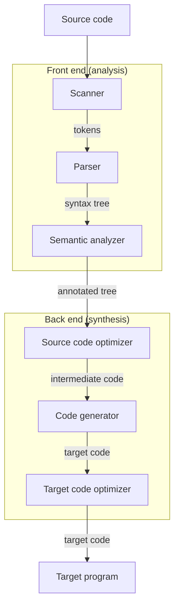

|Phase|Input → Output|
|---|---|
|Scanner|characters → **tokens**|
|Parser|tokens → **syntax (parse) tree**|
|Semantic analyzer|syntax tree → **annotated tree** (types, declarations checked)|
|Source code optimizer|annotated tree → better **intermediate code**|
|Code generator|intermediate code → **target code**|
|Target code optimizer|target code → improved target code|

Two ways to say the same thing, both in the notes:

- `Source code → Analysis → annotated tree`, then `Synthesis → target code`
- `Source code → Front end → intermediate code → Back end → target code`

The **intermediate code** is the boundary. A new language only needs a new front end, and a new machine only needs a new back end.

### Supporting parts that every phase uses _(added)_

|Part|Role|
|---|---|
|Symbol table|Stores what is known about each name (type, scope, location). The semantic analyzer fills and reads it, and the code generator uses it.|
|Literal table|Stores constants and strings so each one is kept once.|
|Error handler|Collects and reports errors from every phase (bad character in the scanner, bad syntax in the parser, type error in the semantic analyzer).|

### Terms: token, lexeme, pattern _(added)_

- **Lexeme**: the actual characters in the source, such as `index` or `4`.
- **Token**: the category the scanner reports, such as `ID` or `NUM`, plus an attribute such as the name or the value.
- **Pattern**: the rule that says which lexemes belong to a token. Patterns are written as regular expressions (next lecture).

### Worked example: from source to target code

The running example in Louden is the assignment `a[index] = 4 + 2`. This matches the tree in my notes, so the earlier ⚠️ is resolved.

**1. Scanner** turns the characters into tokens:

|Lexeme|`a`|`[`|`index`|`]`|`=`|`4`|`+`|`2`|
|---|---|---|---|---|---|---|---|---|
|Token|identifier|left bracket|identifier|right bracket|assign|number|plus|number|

**2. Parser** builds the syntax tree (the tree in my notes):

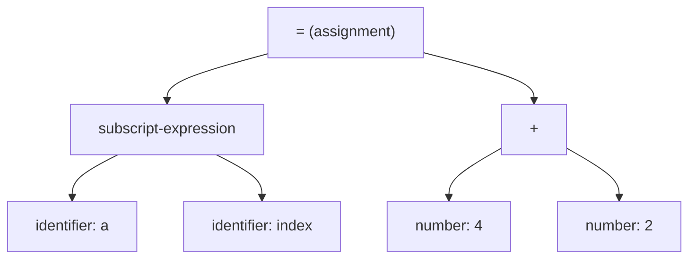

The shape of the tree carries the meaning. `4` and `2` are grouped under `+`, and that whole result is what gets stored into the subscripted position.

**3. Semantic analyzer** checks that `a` is an array, that `index` is an integer, and that the types on both sides of `=` are compatible. The tree is now annotated with these types.

**4. Source code optimizer** can fold the constant: `4 + 2` becomes `6`.

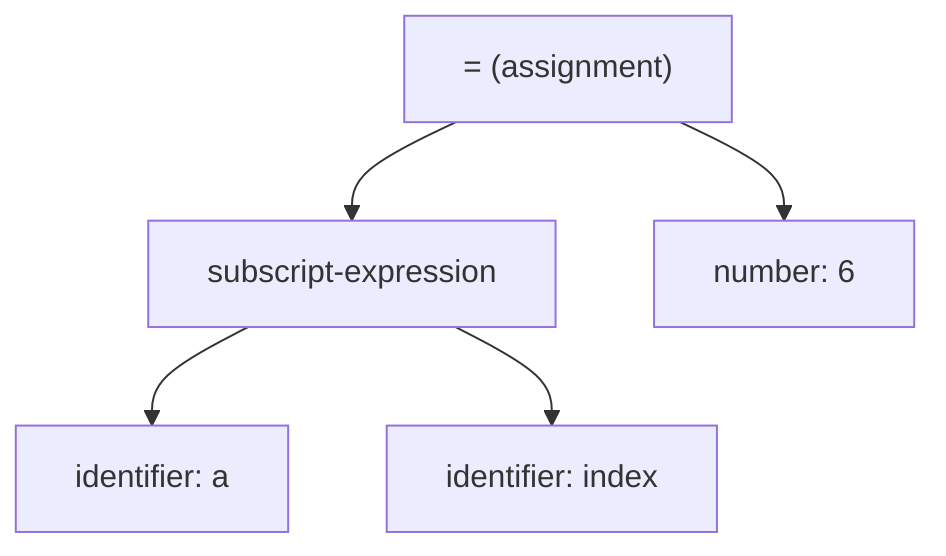

**5. Code generator** produces target code. This is the textbook's sample output for an imaginary machine _(added)_:

```text
MOV R0, index      ; value of index into R0
MUL R0, 2          ; scale by the element size
MOV R1, &a         ; base address of a
ADD R1, R0         ; address of a[index]
MOV *R1, 6         ; store 6 there
```

**6. Target code optimizer** improves the result, for example by choosing a cheaper instruction for the multiply (`MUL R0, 2` becomes a shift).

---

## Lecture 2 — Scanning and regular expressions

The **scanner** reads characters and groups them into **tokens**: identifiers, numbers, operators, keywords. The patterns for tokens are written as **regular expressions**.

### Token categories _(added)_

|Category|Examples|
|---|---|
|Reserved words|`if`, `then`, `while`|
|Special symbols|`+`, `:=`, `<=`, `(`|
|Identifiers|`count`, `x1`|
|Literals / numbers|`42`, `3.14`, `1E5`|

White space and comments are not tokens. The scanner skips them.

### Basic building blocks

Alphabet: $\Sigma = {a, b, c, d}$

|Regex|Matches (language)|Name|
|---|---|---|
|`a`|{a}|single character|
|`ε`|{ε} (the empty string)|epsilon|
|`∅`|{ } nothing|empty set|
|`a\|b`|{a, b}|choice|
|`a\|ε`|{a, ε}|choice with empty|
|`ab`|{ab}|concatenation|
|`(a\|b)c`|{ac, bc}|grouping|
|`(a\|b)*`|{ε, a, b, aa, ab, ba, bb, …}|closure (zero or more)|

**Operator precedence** _(added)_, from highest to lowest: `*` (closure), then concatenation, then `|` (choice). So `ab*` means `a(b*)`, not `(ab)*`, and `a|bc` means `a|(bc)`. Use parentheses to change this.

### Worked language examples

Let `r = (a|b)c` and `s = d|ε`.

|Expression|Language|
|---|---|
|$L(r)$|{ac, bc}|
|$L(s)$|{d, ε}|
|$L(r \mid s)$|{ac, bc, d, ε}|
|$L(rs)$|{acd, bcd, ac, bc}|
|$L(r^+)$|{ac, bc, acac, acbc, bcac, bcbc, …}|

Concatenation `rs` takes every string of `r` followed by every string of `s`. The positive closure `r+` means one or more repetitions of `r`.

### More regex examples _(added)_

Alphabet $\Sigma = {a, b}$:

|Language|Regex|
|---|---|
|all strings|`(a\|b)*`|
|ends with `ab`|`(a\|b)* ab`|
|starts with `a`|`a (a\|b)*`|
|contains `bb` somewhere|`(a\|b)* bb (a\|b)*`|
|even number of `a`'s|`b* (a b* a b*)*`|
|at least one `a`|`b* a (a\|b)*`|

### Handy extensions

These are shorthand. They don't add power, and each one expands into the basic operators.

|Shorthand|Meaning|
|---|---|
|`r+`|one or more of `r` (e.g. `digit+`). It expands to `r r*`.|
|`r?`|optional `r` (zero or one). It expands to `r \| ε`.|
|`.`|any character|
|`[a-z]`, `[a-zA-Z]`|a range of characters|
|`[abc]`|`a\|b\|c`|
|`[^abc]`|any character **except** a, b, c (negation)|

### Token definitions (the Louden-style examples)

```text
digit      = [0-9]
nat        = [0-9]+
signedNat  = (+|-)? nat
number     = signedNat ("." nat)? (E signedNat)?
letter     = [a-zA-Z]
identifier = letter (letter | digit)*
```

Notice how each definition is built from the ones above it. `identifier` starts with a letter and then allows any mix of letters and digits.

Matching examples _(added)_:

|Token|Accepts|Rejects|
|---|---|---|
|`nat`|`0`, `42`, `007`|`` (empty), `4.2`|
|`signedNat`|`-5`, `+12`, `7`|`--5`|
|`number`|`3`, `-3.14`, `2E+8`, `1.5E-3`|`.5`, `3.`, `E5`|
|`identifier`|`x`, `count1`, `a9b`|`9a`, `_x`|

The `number` definition matches the Louden one. The notebook photo is hard to read there, so it is still worth a quick check.

### Exactly one `b`

For $\Sigma = {a, b, c}$, strings containing exactly one `b`:

```text
(a|c)* b (a|c)*        (same as  notb* b notb*  where notb = a|c)
```

### DFA — deterministic finite automaton

A DFA has exactly one move for every (state, symbol) pair. Formally _(added)_ it is a 5-tuple $(Q, \Sigma, T, q_0, F)$:

- $Q$: finite set of states
- $\Sigma$: alphabet
- $T: Q \times \Sigma \to Q$: the transition function
- $q_0$: start state
- $F \subseteq Q$: accepting (final) states

A string is **accepted** if, after reading all of it from $q_0$, the DFA is in a state of $F$.

The matching DFA for "exactly one `b`":

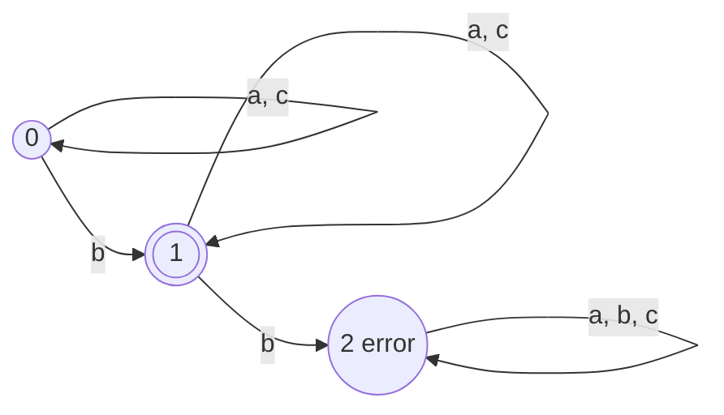

Trace for `aacbaa`:

|Step|Move|State|
|---|---|---|
|a|T(0,a) = 0|0|
|a|T(0,a) = 0|0|
|c|T(0,c) = 0|0|
|b|T(0,b) = 1|1|
|a|T(1,a) = 1|1|
|a|T(1,a) = 1|1|

It ends in state 1, which is accepting, so the string is **accepted**. A second `b` would give $T(1,b) = 2$, and state 2 never leaves itself.

Trace for `abcb` _(added)_:

|Step|Move|State|
|---|---|---|
|a|T(0,a) = 0|0|
|b|T(0,b) = 1|1|
|c|T(1,c) = 1|1|
|b|T(1,b) = 2|2 (error)|

It ends in state 2, which is not accepting, so the string is **rejected**.

> [!note] Error state From the notes: a state you **can't leave** and from which **no accepting state is reachable**. Once the DFA lands there, the string is rejected for good.

### The same DFA as a transition table _(added)_

This is how a scanner actually stores a DFA. Row = state, column = input symbol.

|State|a|b|c|Accepting?|
|---|---|---|---|---|
|0|0|1|0|no|
|1|1|2|1|yes|
|2|2|2|2|no|

```cpp
int T[3][3] = { {0,1,0}, {1,2,1}, {2,2,2} };   // columns: a, b, c
bool accepting[3] = { false, true, false };

bool accept(const string& s)
{
    int state = 0;
    for (char ch : s)
        state = T[state][ch - 'a'];            // one table lookup per character
    return accepting[state];
}
```

### Token recognizers as DFAs

**Identifier.** Stay in the identifier state while the next character is a letter or digit. On any other character, stop and **return that character to the input**, because it belongs to the next token.

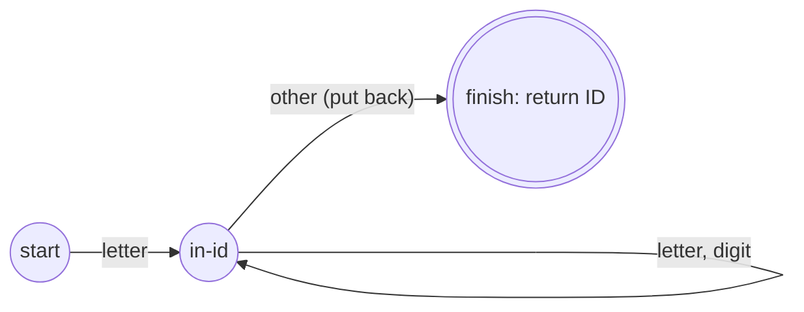

**Operators.** `:=` is assignment, and `<` needs one character of look-ahead to decide between `<=`, `<>` and plain `<`:

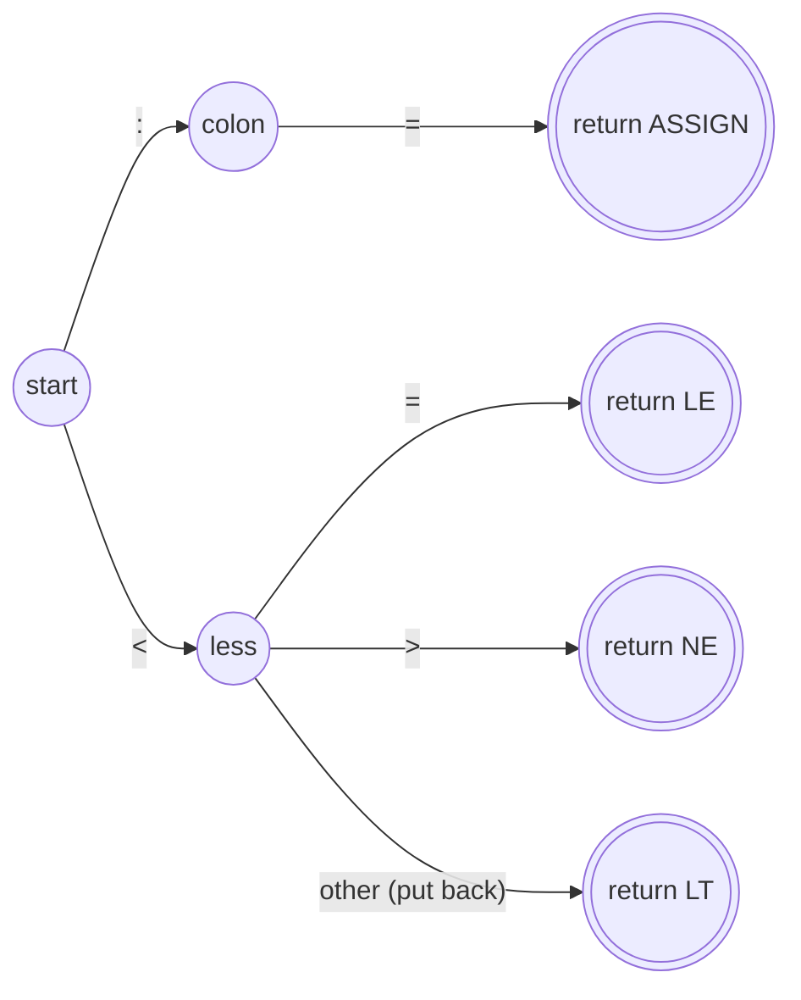

**Numbers** _(added)_: `nat = [0-9]+`.

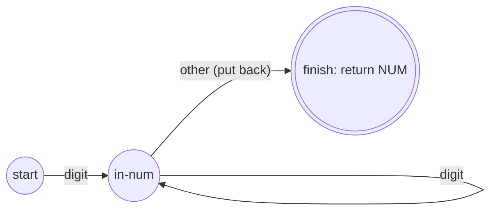

**Comments** _(added)_: in Tiny a comment is `{ … }` with no nesting, so the regex is `{ [^}]* }`. The scanner reads and **throws away** everything between the braces.

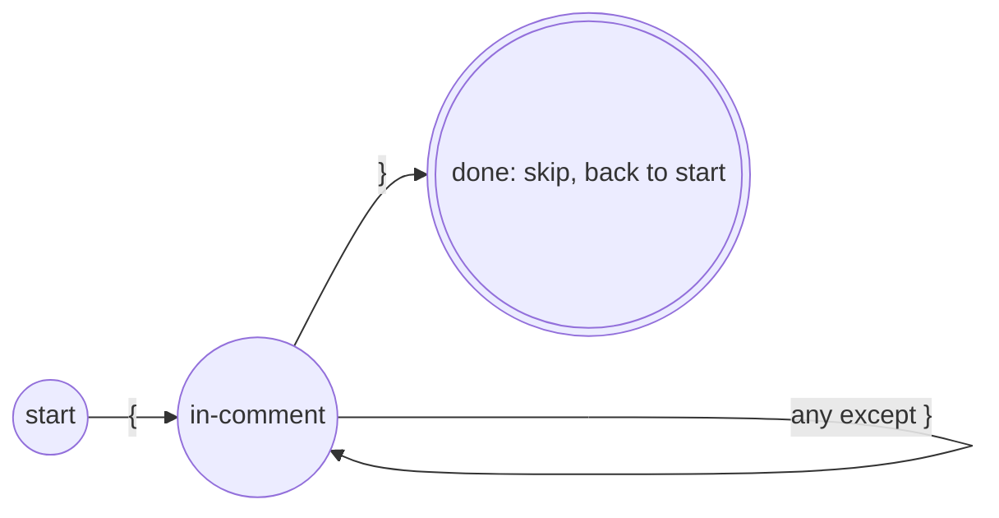

> [!tip] Longest match (maximal munch) _(added)_ When several tokens could match, the scanner takes the **longest** one. `<=` is one token, not `<` then `=`, and `count1` is one identifier, not `count` then `1`. This is why the scanner needs the "put back" move: it reads one character too far to find out the token has ended.

---

## Lecture 3 — RE → NFA → DFA

Writing DFAs by hand is slow. The notes show the automatic route: each token's regex becomes an NFA, the NFAs are combined, and the result is converted to a DFA and minimized.

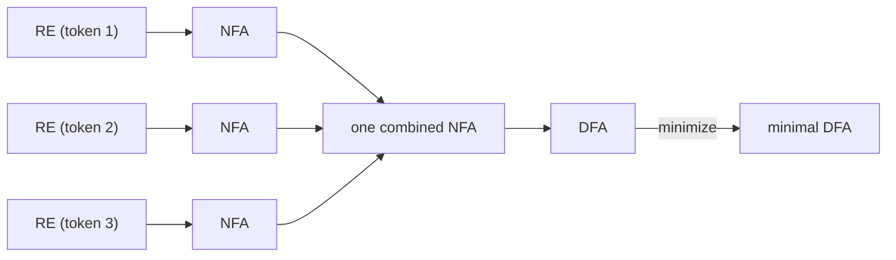

### NFA vs DFA

An **NFA** can have several moves on the same symbol and can move on **ε** without reading anything. A DFA can't. Both recognize exactly the regular languages.

||DFA|NFA|
|---|---|---|
|Moves on a symbol|exactly one|zero, one or several|
|ε-moves|none|allowed|
|Accepts a string when|the single path ends in an accepting state|**some** path ends in an accepting state|
|Easy to build from RE|no|yes (Thompson)|
|Easy to run|yes (one lookup per character)|no (must track a set of states)|
|Size|can be exponentially larger|small (about 2 states per RE symbol)|

**NFA acceptance** _(added)_: the NFA accepts a string if **there exists** at least one path from the start state, reading the string (and using any ε-moves), that ends in an accepting state. Other paths dying or ending in non-accepting states doesn't matter.

### Regular expression → NFA (Thompson's construction)

|RE|NFA|
|---|---|
|`a`|start —a→ accept|
|`ε`|start —ε→ accept|
|`rs`|NFA(r) —ε→ NFA(s)|
|`r\|s`|new start —ε→ NFA(r) and NFA(s); both —ε→ new accept|
|`r*`|ε-arcs that skip NFA(r) or loop back through it|

The drawings _(added)_. Each box is a complete NFA with one start and one accept state.

**Single symbol `a`** and **ε**:

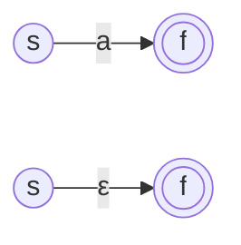

**Concatenation `rs`**: the accept state of `r` is joined to the start of `s` by an ε-arc.

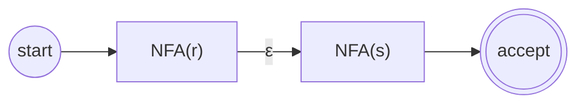

**Choice `r|s`**: a new start branches by ε to both, and both rejoin at a new accept.

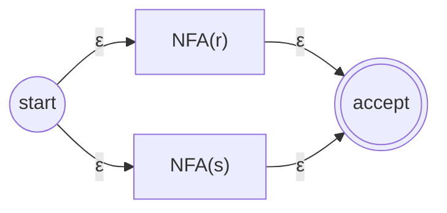

**Closure `r*`**: one arc to skip `r` (zero copies), and one arc back to repeat it.

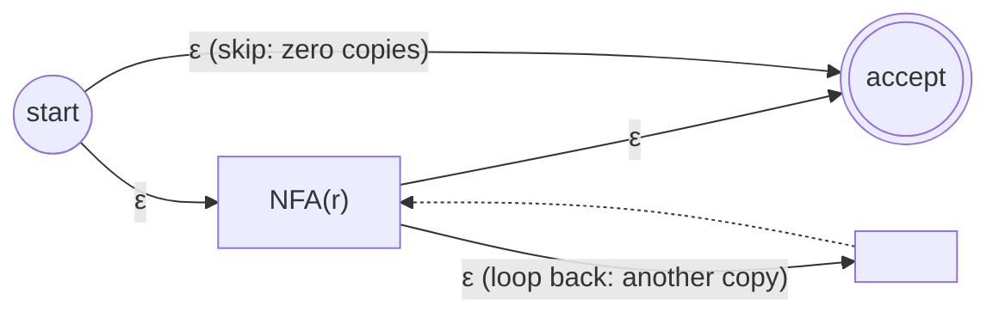

### Full NFA for `letter (letter | digit)*`

Built from the rules above with the state numbers the notebook uses. These numbers are what appear inside the DFA states later. State **10** is the only accepting state.

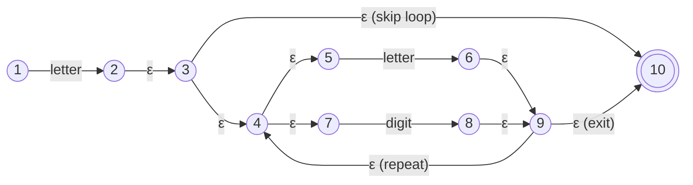

The result is full of ε-moves. That is why the next step exists.

### NFA → DFA: subset construction

> [!note] ε-closure The **ε-closure of a state** is that state plus every state you can reach by following only ε-arcs. For the start state: _start state + any state you go to by ε from the start state_.

Two helper operations _(added)_, both on a **set** of NFA states $S$:

- $\text{move}(S, c)$ = all states reachable from some state in $S$ by **one** arc labelled $c$ (no ε-arcs).
- $\varepsilon\text{-closure}(S)$ = $S$ plus everything reachable from $S$ by ε-arcs only.

**Algorithm**

1. Start DFA state $S_0 = \varepsilon\text{-closure}(\text{start})$.
2. For each unprocessed DFA state $S$ and each symbol $c$: $T = \varepsilon\text{-closure}(\text{move}(S, c))$. If $T$ is new, add it.
3. Repeat until nothing new appears.
4. A DFA state is **accepting** if its set contains an accepting NFA state. This is the double circle in the notes: _accepted when the set contains the goal state_.

```text
S0 = eps_closure({start}); worklist = [S0]
while worklist not empty:
    S = pop(worklist)
    for each symbol c in alphabet:
        T = eps_closure(move(S, c))
        if T is empty: continue            // no transition (error)
        if T not seen before: add T to DFA states and worklist
        DFA.T[S][c] = T
```

An empty set $\varnothing$ means "no NFA state is alive", so the DFA has no transition there.

#### Example 1 from the notes: `ab|a`

Regex `ab|a`, over $\Sigma={a,b}$. NFA with the numbers from the notebook. State **8** is the accepting state.

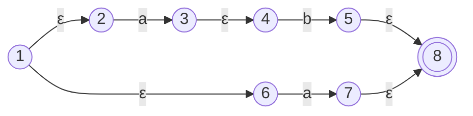

The state numbers match the sets in the notebook table below, so the earlier ⚠️ here is resolved by this reconstruction.

Step by step:

|Step|Computation|Result|
|---|---|---|
|start|ε-closure({1}) = 1, plus 2 and 6 by ε|**{1,2,6}**|
|{1,2,6} on `a`|move: 2→3 and 6→7 gives {3,7}; ε-closure adds 4 (from 3) and 8 (from 7)|**{3,4,7,8}**|
|{1,2,6} on `b`|move gives nothing|∅|
|{3,4,7,8} on `a`|move gives nothing|∅|
|{3,4,7,8} on `b`|move: 4→5 gives {5}; ε-closure adds 8|**{5,8}**|
|{5,8} on `a` or `b`|move gives nothing|∅|

|DFA state|on `a`|on `b`|
|---|---|---|
|{1,2,6}|{3,4,7,8}|∅|
|{3,4,7,8}|∅|{5,8}|
|{5,8}|∅|∅|

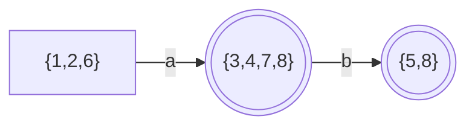

Both `{3,4,7,8}` and `{5,8}` contain 8, so both accept. That gives exactly the two strings of `ab|a`: `a` and `ab`.

#### Example 2 from the notes: `letter (letter | digit)*`

NFA: the 10-state drawing above. State **10** is accepting, and the alphabet is {letter, digit}.

Step by step:

|Step|Computation|Result|
|---|---|---|
|start|ε-closure({1}) = {1}|**{1}**|
|{1} on letter|move = {2}; ε-closure: 2→3→4,10 and 4→5,7|**{2,3,4,5,7,10}**|
|{1} on digit|move = ∅|∅|
|{2,3,4,5,7,10} on letter|move: 5→6 gives {6}; ε-closure: 6→9→4,10 and 4→5,7|**{4,5,6,7,9,10}**|
|{2,3,4,5,7,10} on digit|move: 7→8 gives {8}; ε-closure: 8→9→4,10 and 4→5,7|**{4,5,7,8,9,10}**|
|{4,5,6,7,9,10} on letter / digit|same moves (5→6, 7→8), same closures|{4,5,6,7,9,10} / {4,5,7,8,9,10}|
|{4,5,7,8,9,10} on letter / digit|same moves, same closures|{4,5,6,7,9,10} / {4,5,7,8,9,10}|

|DFA state|on letter|on digit|
|---|---|---|
|{1}|{2,3,4,5,7,10}|∅|
|{2,3,4,5,7,10}|{4,5,6,7,9,10}|{4,5,7,8,9,10}|
|{4,5,6,7,9,10}|{4,5,6,7,9,10}|{4,5,7,8,9,10}|
|{4,5,7,8,9,10}|{4,5,6,7,9,10}|{4,5,7,8,9,10}|

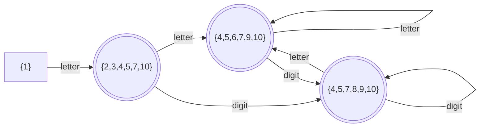

Every set except {1} contains 10, so all three are accepting. They all behave the same way: letter goes to the second state and digit goes to the third. So they can be merged. Renaming the DFA states ① = {1}, ② = {2,3,4,5,7,10}, ③ = {4,5,6,7,9,10}, ④ = {4,5,7,8,9,10}, as the notebook does:

|State|letter|digit|Accepting|
|---|---|---|---|
|①|②|—|no|
|②|③|④|yes|
|③|③|④|yes|
|④|③|④|yes|

Merging ②, ③, ④ gives the small DFA the notebook ends with (minimization is the next lecture):

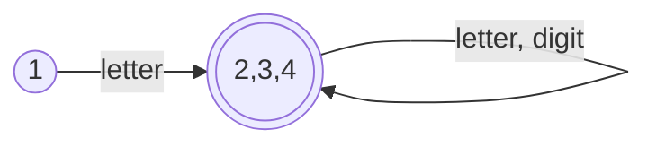

#### Example 3 _(added)_: `(a|b)*abb`

Strings over {a,b} that end with `abb`. A small hand-built NFA is enough here (no ε-moves needed). State **3** accepts.

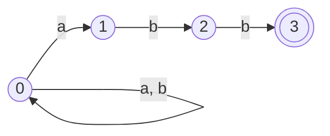

Name the DFA states A = {0}, B = {0,1}, C = {0,2}, D = {0,3}.

|DFA state|NFA set|on `a`|on `b`|Accepting|
|---|---|---|---|---|
|A|{0}|{0,1} = B|{0} = A|no|
|B|{0,1}|{0,1} = B|{0,2} = C|no|
|C|{0,2}|{0,1} = B|{0,3} = D|no|
|D|{0,3}|{0,1} = B|{0} = A|yes (contains 3)|

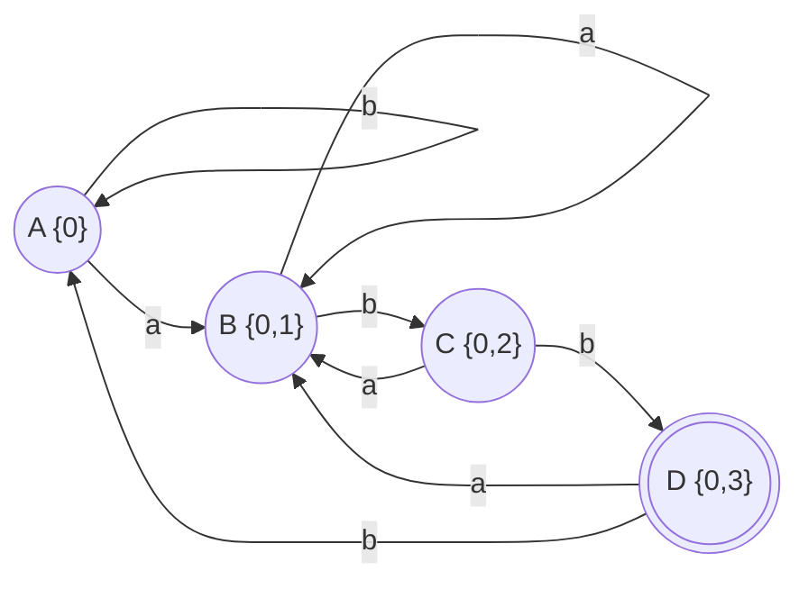

Test `babb`: A –b→ A –a→ B –b→ C –b→ D, which is accepting. ✓

### Combining several tokens in one DFA _(added)_

A real scanner needs **all** tokens at once. Build one NFA with a new start state and an ε-arc to each token's NFA, and remember which accepting state belongs to which token. Then run subset construction on the combined NFA.

Example: two tokens, `IF = if` and `ID = letter (letter | digit)*` (letters shown as `i`, `f`, and other letters).

After reading `if`, the DFA state's NFA set contains **both** the accepting state of IF and the accepting state of ID.

|Input read|Set contains accepting state of|Token returned|
|---|---|---|
|`i`|ID|ID|
|`if`|IF **and** ID|**IF** (reserved words get priority)|
|`ifx`|ID|ID|
|`f`|ID|ID|

Rule: when one DFA state accepts several tokens, return the one listed first (keywords before identifiers). Together with longest match, this decides every case.

> [!tip] Keywords The notebook has the phrase **"minimal perfect hash function"** under this example. The usual idea is that the scanner recognizes any word as an identifier first, then looks it up in a table of reserved words. A minimal perfect hash makes that lookup one step with no collisions.

### Cost of subset construction _(added)_

An NFA with $n$ states can give a DFA with up to $2^n$ states, because each DFA state is a subset. This is rare for programming-language tokens. The minimization step in the next lecture then shrinks the result.

---

## Lecture 4 — DFA minimization

Subset construction often produces more states than needed. **Minimization** merges states that behave identically, giving the smallest DFA for the same language.

### Idea: equivalent states

Two states are **equivalent** if, for every input string, they either both accept or both reject. We find which pairs are **distinguishable** with a pair table.

### Before you start _(added)_

1. The DFA must be **complete**: every state has a move on every symbol. If the notes draw a missing move, add an explicit **error state E** that loops to itself on every symbol (the photos use `E` for this). E is not accepting.
2. Remove states that cannot be reached from the start state.

### Algorithm (table of pairs)

1. List every pair of states.
2. **Iteration 1:** mark a pair **X** if exactly one state is accepting. Pairs where both accept or both reject stay ✓.
3. **Iteration 2 and later:** for each ✓ pair and each symbol, look at where the two states go. If those target states form a pair already marked X, mark this pair **X** too.
4. Stop when an iteration changes nothing. Pairs still ✓ are equivalent, so **merge** them.

> [!important] Propagation rule From the notes: _when one pair isn't equivalent, anything that goes to it isn't equivalent._

**Building the minimized DFA** _(added)_:

- Each group of equivalent states becomes **one** state.
- The group containing the old start state is the new start.
- A group is accepting if its states are accepting (equivalent states are always all accepting or all non-accepting).
- Transitions: take any one state of the group and see which group each symbol leads to.

**Two details that confuse people** _(added)_:

- A pair that leads to **itself** (for example 1→1 on `b` and 2→2 on `b`, so the pair (1,2) leads to (1,2)) does **not** make it distinguishable. It stays ✓ unless some other symbol sends it to an X pair.
- Two states going to the **same** state (for example both to 4) also never distinguish them. Only a target pair marked X does.

### Example 1: the identifier DFA

This is the DFA produced by subset construction for `letter (letter | digit)*`. ① is the start state. ②, ③, ④ are accepting.

|State|letter|digit|Accepting|
|---|---|---|---|
|①|②|—|no|
|②|③|④|yes|
|③|③|④|yes|
|④|③|④|yes|

```mermaid
flowchart LR
    S1((1)) -->|letter| S2((("2")))
    S2 -->|letter| S3((("3")))
    S2 -->|digit| S4((("4")))
    S3 -->|letter| S3
    S3 -->|digit| S4
    S4 -->|letter| S3
    S4 -->|digit| S4
```

(① has no move on digit, so it goes to the error state, which is left out of the drawing. This does not change the result.)

**Iteration 1** (accepting vs not):

|Pair|Result|Why|
|---|---|---|
|(1,2)|X|1 is not accepting, 2 is|
|(1,3)|X|same|
|(1,4)|X|same|
|(2,3)|✓|both accepting|
|(2,4)|✓|both accepting|
|(3,4)|✓|both accepting|

The notebook phrase: _in the first iteration we only check equivalence if both are accepting or both are not._

**Iteration 2** (check transitions of the ✓ pairs):

|State|letter|digit|
|---|---|---|
|2|3|4|
|3|3|4|
|4|3|4|

All three send letter to ③ and digit to ④. They never reach a pair marked X, so (2,3), (2,4), (3,4) stay ✓. The notebook phrase: _in the second iteration we only say they are equivalent if they, on the same letter, lead to states that aren't distinguishable._

States {2,3,4} are equivalent and merge into one:

```mermaid
flowchart LR
    S1((1)) -->|letter| M((("2,3,4")))
    M -->|"letter, digit"| M
```

That is the hand-built identifier recognizer (start, then letter, then loop on letter or digit), and it came out of the algorithm automatically.

### Example 2: `(a|ε)b*` (Louden Example 2.18)

The language is: an optional `a`, then any number of `b`'s. For example `ε`, `a`, `b`, `ab`, `abbb`.

The DFA from the slide. All three states are accepting. The start state is **1**.

```mermaid
flowchart LR
    ST[" "] --> P1((("1")))
    P1 -->|a| P2((("2")))
    P1 -->|b| P3((("3")))
    P2 -->|b| P3
    P3 -->|b| P3
```

|State|a|b|Accepting|
|---|---|---|---|
|1|2|3|yes|
|2|none|3|yes|
|3|none|3|yes|

States 2 and 3 have **no move on `a`**. The slide leaves this out of the drawing. For the algorithm, a missing move means a move to the **error state E**, which is not accepting and loops to itself on every symbol:

```mermaid
flowchart LR
    ST[" "] --> Q1((("1")))
    Q1 -->|a| Q2((("2")))
    Q1 -->|b| Q3((("3")))
    Q2 -->|a| QE(("E error"))
    Q2 -->|b| Q3
    Q3 -->|a| QE
    Q3 -->|b| Q3
    QE -->|"a, b"| QE
```

**The slide's argument:** `a` distinguishes state 1 from states 2 and 3. From state 1, reading `a` reaches an accepting state (2). From state 2 or 3, reading `a` falls into the error state and the string is rejected. So we must split the states into {1} and {2,3}. States 2 and 3 then behave the same on every symbol, so they stay together.

**The same thing as a pair table:**

|Pair|Iteration 1|Iteration 2|Why|
|---|---|---|---|
|(1,2)|✓|X|on `a` it goes to (2,E), and E is not accepting, so (2,E) is X|
|(1,3)|✓|X|on `a` it goes to (2,E), already X|
|(2,3)|✓|✓|on `a` both go to E, and on `b` both go to 3|

Iteration 3 changes nothing. Only (2,3) is equivalent, so {2,3} merge.

> [!note] About the slide's table The slide's table lists the accepting sets as {1}, {2}, {3}, but the text and the final drawing both merge {2,3}. I read the table as an intermediate step before 2 and 3 are compared. The final answer on the slide is the partition {1}, {2,3}.

**Minimized DFA** (matches the last drawing on the slide). The group {2,3} is accepting, {1} is accepting:

```mermaid
flowchart LR
    ST[" "] --> G1((("1")))
    G1 -->|a| G23((("2,3")))
    G1 -->|b| G23
    G23 -->|b| G23
```

### Example 3: four states, a/b alphabet ⚠️

State **3** is the only accepting state in my reading.

|State|a|b|Accepting|
|---|---|---|---|
|0|1|2|no|
|1|3|1|no|
|2|3|2|no|
|3|3|3|yes|

```mermaid
flowchart LR
    Z0((0)) -->|a| Z1((1))
    Z0 -->|b| Z2((2))
    Z1 -->|a| Z3((("3")))
    Z1 -->|b| Z1
    Z2 -->|a| Z3
    Z2 -->|b| Z2
    Z3 -->|"a, b"| Z3
```

|Pair|Iteration 1|Iteration 2|
|---|---|---|
|(0,1)|✓|X: on `a` it goes to (1,3), already X|
|(0,2)|✓|X: on `a` it goes to (1,3), already X|
|(0,3)|X|X|
|(1,2)|✓|✓: on `a` both go to 3, and on `b` it goes to (1,2) itself|
|(1,3)|X|X|
|(2,3)|X|X|

The notebook comment: _1 and 2 are equal on `a` (both go to 3), and on `b` they go back to themselves, so (1,2) stays equivalent. Only (1,2) is equivalent._ This is the "leads back to itself" case from the details above. Merged DFA:

```mermaid
flowchart LR
    Z0((0)) -->|"a, b"| G((("1,2")))
    G -->|b| G
    G -->|a| Z3((("3")))
    Z3 -->|"a, b"| Z3
```

(Here {1,2} is non-accepting and 3 is accepting. In the picture above the double circles only mark the merged group, so read acceptance from the table.)

### Example 4: six states

Accepting states: **4** and **5**.

|State|a|b|Accepting|
|---|---|---|---|
|0|1|2|no|
|1|4|1|no|
|2|4|3|no|
|3|4|3|no|
|4|4|5|yes|
|5|5|5|yes|

```mermaid
flowchart LR
    Q0((0)) -->|a| Q1((1))
    Q0 -->|b| Q2((2))
    Q1 -->|a| Q4((("4")))
    Q1 -->|b| Q1
    Q2 -->|a| Q4
    Q2 -->|b| Q3((3))
    Q3 -->|a| Q4
    Q3 -->|b| Q3
    Q4 -->|a| Q4
    Q4 -->|b| Q5((("5")))
    Q5 -->|"a, b"| Q5
```

Pair table (this is the three-iteration table on the last page; I recomputed it from the transition table):

| Pair  | Iter 1 | Iter 2 | Iter 3 | Why it changes                        |
| ----- | ------ | ------ | ------ | ------------------------------------- |
| (0,1) | ✓      | X      | X      | iter 2: on `a` → (1,4), already X     |
| (0,2) | ✓      | X      | X      | iter 2: on `a` → (1,4)                |
| (0,3) | ✓      | X      | X      | iter 2: on `a` → (1,4)                |
| (0,4) | X      | X      | X      | one accepting                         |
| (0,5) | X      | X      | X      | one accepting                         |
| (1,2) | ✓      | ✓      | ✓      | `a`: (4,4) same; `b`: (1,3) is ✓      |
| (1,3) | ✓      | ✓      | ✓      | `a`: (4,4) same; `b`: (1,3) is itself |
| (1,4) | X      | X      | X      | one accepting                         |
| (1,5) | X      | X      | X      | one accepting                         |
| (2,3) | ✓      | ✓      | ✓      | `a`: (4,4); `b`: (3,3) same           |
| (2,4) | X      | X      | X      | one accepting                         |
| (2,5) | X      | X      | X      | one accepting                         |
| (3,4) | X      | X      | X      | one accepting                         |
| (3,5) | X      | X      | X      | one accepting                         |
| (4,5) | ✓      | ✓      | ✓      | `a`: (4,5) itself; `b`: (5,5) same    |

Iteration 3 changes nothing, so stop. The pairs still ✓ are (1,2), (1,3), (2,3) and (4,5). The merged groups are **{1,2,3}** and **{4,5}**, with **0** on its own.

```mermaid
flowchart LR
    G0((0)) -->|"a, b"| G1((1,2,3))
    G1 -->|b| G1
    G1 -->|a| G2((("4,5")))
    G2 -->|"a, b"| G2
```

### Example 5 _(added)_: a chain where marks spread over three iterations

This example shows the propagation rule at work. The language is "strings over {a,b} that end with `aaa`". State **3** is accepting.

|State|a|b|Accepting|
|---|---|---|---|
|0|1|0|no|
|1|2|0|no|
|2|3|0|no|
|3|3|0|yes|

|Pair|Iter 1|Iter 2|Iter 3|Why|
|---|---|---|---|---|
|(0,3)|X|X|X|one accepting|
|(1,3)|X|X|X|one accepting|
|(2,3)|X|X|X|one accepting|
|(0,2)|✓|X|X|iter 2: on `a` → (1,3), already X|
|(1,2)|✓|X|X|iter 2: on `a` → (2,3), already X|
|(0,1)|✓|✓|X|iter 2: on `a` → (1,2), still ✓ at that time. iter 3: (1,2) is now X, so (0,1) becomes X|

Iteration 4 changes nothing. Every pair is X, so no states merge: this DFA is **already minimal**. Notice that (0,1) only became X in iteration 3, because it depended on (1,2), which only became X in iteration 2. That is why we repeat until nothing changes.

### Cost (as noted)

- Time: $O(n^2 \cdot |\Sigma|)$ (the Assignment 1 board in Lecture 5 states this target)
- Space: $O(n^2)$ ⚠️ (the photo may actually say $O(n^2 \cdot |\Sigma|)$; check the notebook)

where $n$ is the number of states and $|\Sigma|$ the alphabet size. The table has about $n^2/2$ pairs, and each pair checks one transition per symbol.

> [!warning] Repeating the whole table is too slow for the target _(added)_ The simple "repeat until nothing changes" method costs $O(n^2|\Sigma|)$ **per pass** and can take many passes. To reach $O(n^2|\Sigma|)$ in total, mark each pair once. When a pair becomes X, use the **reverse transitions** (which pairs lead into it on some symbol) to mark those pairs X too, and never revisit them. Each (pair, symbol) combination is then handled at most once.

---

## Lecture 5 — Parsing, ambiguity and top-down parsing

> [!note] Source Lectures 1–4 came from my notebook. This one comes from photos of the whiteboard, so the grammars, code and drawings are the lecturer's. Things I worked out myself are marked _(added)_. Things I couldn't read clearly are marked ⚠️.

### 1. What the parser does

The parser reads the **tokens** from the scanner, checks them against a **context-free grammar** written in BNF, and builds a tree for the later phases.

```text
<exp> → <exp> <op> <exp> | number
<op>  → + | - | *
```

Nonterminals are in angle brackets, `|` separates alternatives, and everything else is a terminal (a token).

#### Derivations _(added)_

A **derivation** starts from the start symbol and replaces one nonterminal at a time using a production, until only terminals are left. In a **leftmost** derivation you always expand the leftmost nonterminal. Derivation of `3 + 4`:

```text
<exp> ⇒ <exp> <op> <exp>
      ⇒ number <op> <exp>      (first <exp> → number, giving 3)
      ⇒ number + <exp>         (<op> → +)
      ⇒ number + number        (last <exp> → number, giving 4)
```

The parse tree is the picture of the derivation (next section). **Ambiguity** means one string has two different parse trees, that is, two essentially different derivations.

#### EBNF shorthand _(added)_

|Notation|Meaning|
|---|---|
|`[ x ]`|x is optional|
|`{ x }`|zero or more repetitions of x|
|`( x \| y )`|choice inside a group|

### 2. Parse tree vs syntax tree

|                | Parse tree                     | Syntax tree                                    |
| -------------- | ------------------------------ | ---------------------------------------------- |
| Other name     | concrete syntax tree           | abstract syntax tree (AST)                     |
| Internal nodes | nonterminals (`<exp>`, `<op>`) | operators or statement kinds (`+`, `*`, `if`)  |
| Leaves         | tokens                         | operands (numbers, identifiers)                |
| Records        | every production used          | only the structure that carries meaning        |
| Parentheses    | kept as tokens                 | gone; the tree shape already says the grouping |

**Example `3 + 4`** with the grammar above:

```mermaid
flowchart TD
    subgraph PT["Parse tree"]
        E0["exp"] --> E1["exp"]
        E0 --> OP["op"]
        E0 --> E2["exp"]
        E1 --> N1["number: 3"]
        OP --> PL["+"]
        E2 --> N2["number: 4"]
    end
    subgraph ST["Syntax tree"]
        S0["+"] --> S3["3"]
        S0 --> S4["4"]
    end
```

**Example `(5 - 3) * 2`.** The syntax tree has no parentheses. Their effect is kept in the shape: `5 - 3` sits below the `*`, so it is computed first.

```mermaid
flowchart TD
    M["*"] --> S["-"]
    M --> T2["2"]
    S --> F5["5"]
    S --> F3["3"]
```

### 3. Ambiguity

A grammar is **ambiguous** if some string has more than one parse tree. The board separates two cases, depending on whether the ambiguity changes the meaning.

#### Essential ambiguity: `5 - 3 * 2` _(added)_

The board draws both syntax trees: one for `(5 - 3) * 2` and one for `5 - 3 * 2`. With the plain grammar `<exp> → <exp> <op> <exp>`, the string `5 - 3 * 2` could be parsed either way:

|Grouping|Syntax tree|Value|
|---|---|---|
|(5 − 3) × 2|`*`( `-`(5, 3), 2 )|4|
|5 − (3 × 2)|`-`( 5, `*`(3, 2) )|−1|

```mermaid
flowchart TD
    subgraph A["Reading 1: (5 - 3) * 2 = 4"]
        A1["*"] --> A2["-"]
        A1 --> A3["2"]
        A2 --> A4["5"]
        A2 --> A5["3"]
    end
    subgraph B["Reading 2: 5 - (3 * 2) = -1"]
        B1["-"] --> B2["5"]
        B1 --> B3["*"]
        B3 --> B4["3"]
        B3 --> B5["2"]
    end
```

The value changes, so this ambiguity is a real problem. The fix is to build precedence into the grammar with separate levels (`<expr>` over `<term>`), which is what the recursive descent examples below do.

**The precedence fix** _(added)_. Make `*` bind tighter than `+` and `-` by giving it its own level, and make both levels left-recursive so they group to the left:

```text
<exp>    → <exp> <addop> <term> | <term>
<addop>  → + | -
<term>   → <term> <mulop> <factor> | <factor>
<mulop>  → *
<factor> → ( <exp> ) | number
```

Now `5 - 3 * 2` has **only one** parse tree. The `*` must be grouped inside a `<term>`, so `3 * 2` is built first, and the `-` joins `5` and that `<term>` at the `<exp>` level. The result is `5 - (3 * 2) = -1`. To force the other grouping you must write the parentheses, `(5 - 3) * 2`, which the `<factor>` rule allows.

#### Inessential ambiguity: `s ; s ; s`

Grammar from the board (second symbol after `;` is `<stmtseq>`, which Louden's textbook confirms, since otherwise the grammar would not be ambiguous):

```text
<stmtseq> → <stmtseq> ; <stmtseq> | <stmt>
<stmt>    → s
```

`s ; s ; s` can be grouped as `(s;s);s` or `s;(s;s)`, so there are two parse trees. But both mean "run three statements in order", so the grouping doesn't matter. The board draws the two nested trees and then collapses them into one `seq` node with three children (also drawn as a sibling-linked list `S — S — S`).

```mermaid
flowchart TD
    subgraph A["Grouped (s;s);s"]
        A1[";"] --> A2[";"]
        A1 --> A3["s"]
        A2 --> A4["s"]
        A2 --> A5["s"]
    end
    subgraph B["Grouped s;(s;s)"]
        B1[";"] --> B2["s"]
        B1 --> B3[";"]
        B3 --> B4["s"]
        B3 --> B5["s"]
    end
    subgraph C["What we keep: one seq node"]
        C1["seq"] --> C2["s"]
        C1 --> C3["s"]
        C1 --> C4["s"]
    end
```

> [!note] Essential or not? Ask: do the different parse trees lead to different meanings? `5 - 3 * 2` does (4 vs −1). `s;s;s` doesn't, because `;` is associative.

#### The dangling else problem

```text
if (0) if (1) other else other
```

The `else` could belong to the outer `if` or the inner one. The board boxes the inner `if (1) other` and writes the intended reading:

```text
if (0) { if (1) other else other }
```

The two possible readings _(added)_:

```mermaid
flowchart TD
    subgraph R1["Reading 1 (wanted): else goes with the inner if"]
        O1["if (0)"] --> I1["if (1) other else other"]
    end
    subgraph R2["Reading 2 (not wanted): else goes with the outer if"]
        O2["if (0) ... else other"] --> I2["if (1) other"]
    end
```

**Rule:** the `else` goes with the **nearest** `if` that doesn't have one yet. The grammar `<ifstmt> → if (<exp>) <stmt> [else <stmt>]` from the recursive descent board is ambiguous in exactly this way _(added)_.

**Unambiguous grammar from the board:**

```text
<stmt>      → <matched> | <unmatched>
<matched>   → if (<exp>) <matched> else <matched> | other
<unmatched> → if (<exp>) <stmt>
            | if (<exp>) <matched> else <unmatched>
<exp>       → 0 | 1
```

- **matched**: every `if` inside has its `else`, so nothing is left dangling.
- **unmatched**: at least one `if` is missing its `else`.
- The key restriction: the _then_ part of an `if … else` must be **matched**. An inner `if` without an `else` can't sit there, so the `else` has to pair with the inner `if`.

Parse tree of `if (0) if (1) other else other`, as drawn on the board:

```mermaid
flowchart TD
    S0["stmt"] --> U["unmatched"]
    U --> I1["if"]
    U --> LP1["("]
    U --> E1["exp"]
    U --> RP1[")"]
    U --> S1["stmt"]
    E1 --> Z["0"]
    S1 --> M["matched"]
    M --> I2["if"]
    M --> LP2["("]
    M --> E2["exp"]
    M --> RP2[")"]
    M --> M1["matched"]
    M --> EL["else"]
    M --> M2["matched"]
    E2 --> ONE["1"]
    M1 --> O1["other"]
    M2 --> O2["other"]
```

Why can't the `else` attach to the outer `if`? That would need `if (0) <matched> else …` with `<matched>` = `if (1) other`. But `if (1) other` has no `else`, so it is not matched. Only the inner pairing is derivable.

> [!tip] Recursive descent gets this rule for free _(added)_ In `IfStmt()` (below), the `then` part calls `Stmt()`, which runs the inner `IfStmt()` first. That inner call checks `token == "else"` before the outer one gets a chance, so it grabs the `else`. The grammar can stay ambiguous, and the code enforces "nearest `if`".

### 4. Top-down vs bottom-up

```mermaid
flowchart LR
    TD["Top-down parsing"] --> RD["Recursive descent"]
    TD --> LL["LL(1)"]
    BU["Bottom-up parsing"] --> SLR["SLR(1)"]
    BU --> LR["LR(1)"]
    BU --> LALR["LALR(1)"]
```

||Top-down|Bottom-up|
|---|---|---|
|Starts from|the start symbol|the tokens|
|Builds the parse tree|from the root down|from the leaves up|
|Decision|predict which production to use from the next token|read tokens, then reduce when a right-hand side is complete|
|On this board|recursive descent, LL(1)|SLR(1), LR(1), LALR(1) (names only)|

In **LL(1)** the first L is "scan left to right", the second is "leftmost derivation", and the 1 is one token of lookahead _(added, standard meaning)_.

#### Which grammars work with which method

The board draws nested circles:

```mermaid
flowchart TB
    subgraph CFG["Context-free grammars"]
        subgraph LR1["LR(1) grammars"]
            LL1["LL(1) grammars"]
        end
    end
```

Every LL(1) grammar is also LR(1), but not the other way around. Some context-free grammars (for example ambiguous ones) are in neither set.

#### The grammar matters, not just the language

The board also shows the same language with two different grammars. One is marked ✓ for top-down, the other ✗. A second pair of grammars for a different language has both crossed out ⚠️. My reading:

- Being top-down parsable is a property of the **grammar**. Rewriting the grammar can fix a ✗ one.
- Some languages have **no** grammar that works top-down at all.

```mermaid
flowchart LR
    G1["grammar 1: top-down OK"] --> LA(("language A"))
    G2["grammar 2: top-down fails"] --> LA
    G3["grammar 1: fails"] --> LB(("language B"))
    G4["grammar 2: fails"] --> LB
```

A concrete pair of grammars is written right above the sketches on the board ⚠️:

|Grammar|Shape|Top-down?|
|---|---|---|
|`<exp> → <exp> * <term> \| <term>`|left-recursive, groups to the left: `(((a*b)*c)*d)`|✗ infinite recursion|
|`<exp> → <term> * <exp> \| <term>`|right-recursive, groups to the right: `(a*(b*(c*d)))`|✓ after parsing `<term>` first|

Both generate the same strings (terms separated by `*`). Only the tree shape and the top-down friendliness differ.

> [!note] Why "after parsing `<term>` first" _(added)_ Both alternatives of the right-recursive grammar start with `<term>`, so one token of lookahead can't choose between them yet. The fix is **left factoring**: take the common start out. `<exp> → <term> * <exp> | <term>` becomes `<exp> → <term> [ * <exp> ]`. In code: parse `<term>`, then look at the next token. If it is `*`, continue. If not, stop. This is exactly what `Exp()` below does.

### 5. Recursive descent

**Idea:** write one function per nonterminal. Each function's body mirrors the right-hand side of its production. The calls nest the same way as the parse tree, and each function **returns the syntax tree** for its part.

#### The machinery (from the board)

```cpp
Token token;                       // the current lookahead token

void Match(Token expectedToken)
{
    if (token == expectedToken)
        token = getToken();        // consume it and fetch the next one
    else
        Error();
}

int main()
{
    token = getToken();            // prime the lookahead
    Node* tree = Program();        // start at the start symbol
}
```

#### Grammar → code _(added)_

|Grammar piece|Code|
|---|---|
|terminal `t`|`Match(t);`|
|nonterminal `<A>`|`A()` (returns a tree)|
|`[ x ]` optional|`if (token == <start of x>) { … }`|
|`{ x }` repetition|`while (token == <start of x>) { … }`|
|`x \| y` choice|`if` / `switch` on `token`|

#### Example 1: `IfStmt` (optional else)

```text
<ifstmt> → if ( <exp> ) <stmt> [ else <stmt> ]
```

```cpp
Node* IfStmt()
{
    Match("if");
    Match("(");
    Node* tree = makeStmtNode("if");
    tree->test_child = Exp();
    Match(")");
    tree->then_child = Stmt();
    if (token == "else")
    {
        Match("else");
        tree->else_child = Stmt();
    }
    else
        tree->else_child = null;
    return tree;                   // not visible on the board, but needed
}
```

The `[ else … ]` part becomes one `if`: one token of lookahead decides whether the `else` is there.

```mermaid
flowchart TD
    IF["if"] -->|test_child| T["Exp()"]
    IF -->|then_child| TH["Stmt()"]
    IF -->|else_child| EL["Stmt() or null"]
```

#### Example 2: `Exp` (right-associative `^`)

```text
<exp> → <term> ^ <exp> | <term>
```

Both alternatives start with `<term>`. So parse the term once, then look at the next token to decide which alternative it was:

```cpp
Node* Exp()
{
    Node* term_tree = Term();
    if (token != "^")
        return term_tree;                  // second alternative: just <term>
    Match("^");
    Node* tree = MakeOpNode("^");
    tree->left_child  = term_tree;
    tree->right_child = Exp();             // recursion on the RIGHT
    return tree;
}
```

The recursive call is on the right child, so the tree leans right: `a ^ b ^ c` is `a ^ (b ^ c)`. The board draws a `^` node with `<term>` on the left and a circle (the result of `Exp()`) on the right.

```mermaid
flowchart TD
    P1["^"] --> A["a"]
    P1 --> P2["^"]
    P2 --> B["b"]
    P2 --> C["c"]
```

Example _(added)_: `2 ^ 3 ^ 2` = 2^(3^2) = 512, not (2^3)^2 = 64.

#### Example 3: `Expr` (left-associative `+` and `-`)

```text
<expr> → <expr> + <term> | <expr> - <term> | <term>
```

This is **left-recursive**: the first thing `Expr()` would do is call `Expr()` again without consuming a token. The board shows exactly this problem:

```cpp
void exp()
{
    exp();      // calls itself forever
    …
}
```

**Fix:** the grammar really says "a term, then zero or more (`+` or `-`) term". Write it as a loop:

```text
<expr> → <term> { ( + | - ) <term> }
```

```cpp
Node* Expr()
{
    Node* cur_tree = Term();
    while (token == "+" || token == "-")
    {
        Node* new_tree = makeOpNode(token);
        Match(token);
        new_tree->left_child  = cur_tree;      // everything so far goes LEFT
        new_tree->right_child = Term();
        cur_tree = new_tree;
    }
    return cur_tree;
}
```

**Trace of `3 + 4 - 5`** (the two drawings on the board):

|Step|token|Action|`cur_tree` after|
|---|---|---|---|
|start|`3`|`cur_tree = Term()`|`3`|
|1|`+`|`new_tree` = `+`, left = `cur_tree`, right = `Term()` = 4|`(3 + 4)`|
|2|`-`|`new_tree` = `-`, left = `(3 + 4)`, right = `Term()` = 5|`((3 + 4) - 5)`|
|end|—|token isn't `+` or `-`, so `return cur_tree`||

```mermaid
flowchart TD
    MI["- (new_tree)"] --> PL["+ (old cur_tree)"]
    MI --> F5["5"]
    PL --> F3["3"]
    PL --> F4["4"]
```

> [!important] Why a loop and not right recursion _(added)_ Rewriting `<expr> → <term> + <expr>` would also remove the left recursion, but it groups to the right. For `10 - 4 - 3` that gives `10 - (4 - 3) = 9` instead of the correct `(10 - 4) - 3 = 3`. The loop keeps the left grouping.

#### General recipe: removing left recursion _(added)_

Any rule of the form

```text
<A> → <A> α | β          (α = what follows, β = a way to start)
```

generates "β followed by zero or more α", so rewrite it as

```text
<A> → β { α }
```

and the code is `Node* cur = B(); while (token starts α) { … }`. For `<expr> → <expr> + <term> | <term>`: β = `<term>`, α = `+ <term>`.

#### Example 4 _(added)_: the full expression grammar with precedence

Combine the precedence grammar from the ambiguity section with the loop recipe, with one function per level:

```text
<exp>    → <term> { <addop> <term> }
<term>   → <factor> { <mulop> <factor> }
<factor> → ( <exp> ) | number
```

```cpp
Node* Exp()
{
    Node* cur = Term();
    while (token == "+" || token == "-")
    {
        Node* n = makeOpNode(token);
        Match(token);
        n->left_child  = cur;
        n->right_child = Term();
        cur = n;
    }
    return cur;
}

Node* Term()
{
    Node* cur = Factor();
    while (token == "*")
    {
        Node* n = makeOpNode(token);
        Match(token);
        n->left_child  = cur;
        n->right_child = Factor();
        cur = n;
    }
    return cur;
}

Node* Factor()
{
    if (token == "(")
    {
        Match("(");
        Node* tree = Exp();
        Match(")");
        return tree;                       // no node for the parentheses
    }
    else if (token == number)
    {
        Node* tree = makeNumNode(token);
        Match(number);
        return tree;
    }
    else
        Error();
}
```

The grammar has one function per level. The lower the precedence, the higher up the call chain it sits, so `Exp()` calls `Term()`, which calls `Factor()`. That forces `*` to be built deeper in the tree than `+` and `-`.

**Trace of `5 - 3 * 2`:**

|Step|Call|Result|
|---|---|---|
|1|`Exp()` calls `Term()`, which calls `Factor()`|`5` (then `Term()` sees `-`, not `*`, and returns `5`)|
|2|`Exp()` sees `-`, so `n = -`, left = `5`, then calls `Term()`||
|3|`Term()`: `Factor()` = `3`, sees `*`, builds `*`(3, `Factor()` = 2)|`(3 * 2)`|
|4|back in `Exp()`: right child = `(3 * 2)`; next token ends the loop|`-`( 5, `*`(3, 2) ) = −1|

```mermaid
flowchart TD
    M["-"] --> F5["5"]
    M --> T["*"]
    T --> F3["3"]
    T --> F2["2"]
```

**Trace of `(5 - 3) * 2`:** `Exp()` → `Term()` → `Factor()` sees `(`, matches it, calls `Exp()`, which builds `-`(5, 3), then matches `)` and returns that tree. Back in `Term()`, the token is `*`, so it builds `*`( `-`(5,3), 2 ). That is the syntax tree from section 2, with no parenthesis nodes.

#### Left vs right recursion, side by side

||Left-recursive|Right-recursive|
|---|---|---|
|Grammar|`<expr> → <expr> + <term> \| <term>`|`<exp> → <term> ^ <exp> \| <term>`|
|Plain top-down|infinite recursion|works (after parsing `<term>` first)|
|Tree shape|`((a + b) + c)`|`a ^ (b ^ c)`|
|Associativity|left (`+`, `-`, `*`, `/`)|right (`^`)|
|In code|`while` loop with `cur_tree` / `new_tree`|recursive call for the right child|

#### When the lookahead decides _(added)_

A recursive descent function must pick the right alternative from **one** token. This works when the alternatives start with different tokens:

|Grammar|First token of each alternative|Decidable with 1 token?|
|---|---|---|
|`<factor> → ( <exp> ) \| number`|`(` / number|yes|
|`<stmt> → if … \| while … \| id := …`|`if` / `while` / id|yes|
|`<A> → a b \| a c`|`a` / `a`|no, so left-factor it: `<A> → a ( b \| c )`|
|`<A> → <A> a \| b`|`<A>` / `b` (left recursion)|no, so use a loop|

### 6. Assignment 1

> [!todo] As written on the board
> 
> - Language: **C++**
> - Task: **minimize a DFA in O(n²·|Σ|) time**
> - Write **all the test cases we took in lecture**
> - Teams of **at most 5 students**
> - **Deliver in lecture**
> - Cover page with **names and IDs** ⚠️
> - Document font size **12** ⚠️
> - Coding style ⚠️: no `int a[n];` (crossed out). Use a fixed size such as `int a[100]` (with `#define A 100`) or `int* a = new int[n];`. Put the `{` on its own line after `if (…)` and `for (…)`; the same-line version is crossed out. A `while (true)` with a `break` is also sketched.

> [!tip] Hint on the complexity target _(added)_ The minimization rule is: when one pair isn't equivalent, anything that goes to it isn't equivalent. Re-scanning every pair on every iteration costs more than O(n²·|Σ|). Mark each pair once, and when a pair becomes distinguishable, push that fact backward through the reverse transitions to the pairs that lead into it. Each (pair, symbol) combination is then handled at most once, which is n²·|Σ| work in total.
> 
> Test cases to include: the identifier DFA (3 accepting states merge into 1), the 6-state a/b DFA (groups {1,2,3} and {4,5}), a DFA that is already minimal, and a DFA with a state that can't be reached.

### 7. Self-test

> [!question]- Why does a plain `Expr()` for `<expr> → <expr> + <term>` never finish? Its first action is to call `Expr()` again, before consuming any token. The recursion never gets smaller. Left recursion must be rewritten as a loop.

> [!question]- Draw the trees for `3 + 4 - 5` and `2 ^ 3 ^ 2`. `3 + 4 - 5` → `-`( `+`(3, 4), 5 ), leaning left. `2 ^ 3 ^ 2` → `^`( 2, `^`(3, 2) ), leaning right.

> [!question]- In `if (0) if (1) other else other`, which `if` owns the `else`, and how does the matched/unmatched grammar enforce it? The inner `if (1)`. The _then_ part of an `if … else` must be `<matched>`, and an `if` without an `else` is not matched, so the `else` can't attach to the outer `if`.

> [!question]- What is the difference between a parse tree and a syntax tree for `(5 - 3) * 2`? The parse tree has `<exp>` and `<op>` nodes and the parentheses as tokens. The syntax tree is just `*`( `-`(5, 3), 2 ). There are no parentheses, because the shape already encodes the grouping.

> [!question]- Why is the ambiguity in `s;s;s` "inessential" but the one in `5 - 3 * 2` is not? Both groupings of `s;s;s` collapse to the same sequence of three statements, so the meaning is unchanged. The two groupings of `5 - 3 * 2` give different values (4 vs −1).

> [!question]- How does the grammar `<exp> → <exp> <addop> <term> | <term>` with a separate `<term>` level fix `5 - 3 * 2`? _(added)_ `*` can only be built inside a `<term>`, so `3 * 2` is always grouped first. The `-` then joins `5` and that term. Only one parse tree exists, with value −1.

> [!question]- Why is `<A> → a b | a c` a problem for recursive descent, and how do you fix it? _(added)_ Both alternatives start with `a`, so one token of lookahead can't choose. Left-factor it: `<A> → a ( b | c )`. Match `a`, then look at the next token.

---


> [!note] Left out One page has a linear-programming problem (maximize $z = 2x_1 + x_2$ with $x_1 - x_2 \le 10$, $x_1 \le 20$, $x_1, x_2 \ge 0$, marked _unbounded_). It isn't compiler material, so it isn't in this note.
